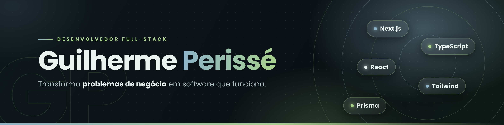

<!-- ============ HEADER ============ -->

 

  

  

<!-- ============ SOBRE ============ -->
<h2 align="center">👋 Sobre mim</h2>

Sou **desenvolvedor full-stack e negociador comercial na prática, não só na teoria**. 💡

Estudo **Ciências Exatas** na UFJF, com segundo ciclo em **Engenharia Computacional**, e uso essa mistura de visão técnica e comercial para entender os problemas de negócio de verdade e transformá-los em **soluções de software que funcionam**.

🗣️ Converso com o cliente, faço o diagnóstico e levo a proposta até a entrega. 
⚙️ Construo aplicações modernas com **Next.js, React e TypeScript**. 
🔬 Fui monitor de Física, então sei explicar coisa complexa de um jeito simples.

Curioso, direto ao ponto e sempre aprendendo. 🚀

 

<!-- ============ STACK ============ -->
<h2 align="center">🛠️ Minha Stack</h2>

  
  
  

<!-- ============ PROJETOS ============ -->
<h2 align="center">🚀 Projetos em Destaque</h2>

<i>Desenvolvidos em equipe durante minha atuação na Code Empresa Júnior</i>

### 🛒 Plataforma de E-commerce
Desafio técnico • Jun – Ago 2026

Aplicação full-stack construída do zero. O banco foi modelado com **diagramas ER (Graphviz)** antes de qualquer linha de código, integrado ao front via **Prisma**, com navegação dinâmica, responsiva e **deploy em produção na Vercel**.

### 💼 Sistema EJ
Sistema interno de precificação • Out 2026 – atual

Ferramenta em **Next.js (App Router) + TypeScript** com regras de negócio desacopladas, validações e **testes unitários**. Interfaces responsivas e acessíveis a partir do Figma, com **tema claro/escuro** e componentes reutilizáveis. Trabalho em equipe com branches, Pull Requests e ESLint.

### 🌿 Rastros de Fibras
Blog institucional • Trainee • Abr – Jun 2026

Projeto em equipe de 4 pessoas, cobrindo toda a interface, com dailys e apresentações de validação direto com o cliente.

<!-- ============ GITHUB ============ -->
<h2 align="center">📊 Meu GitHub em Números</h2>

 

  

  

 

<!-- ============ CONTATO ============ -->
<h2 align="center">🤝 Vamos conversar?</h2>

Tem uma ideia, um problema de negócio ou só quer trocar uma ideia sobre tecnologia?

  

  

